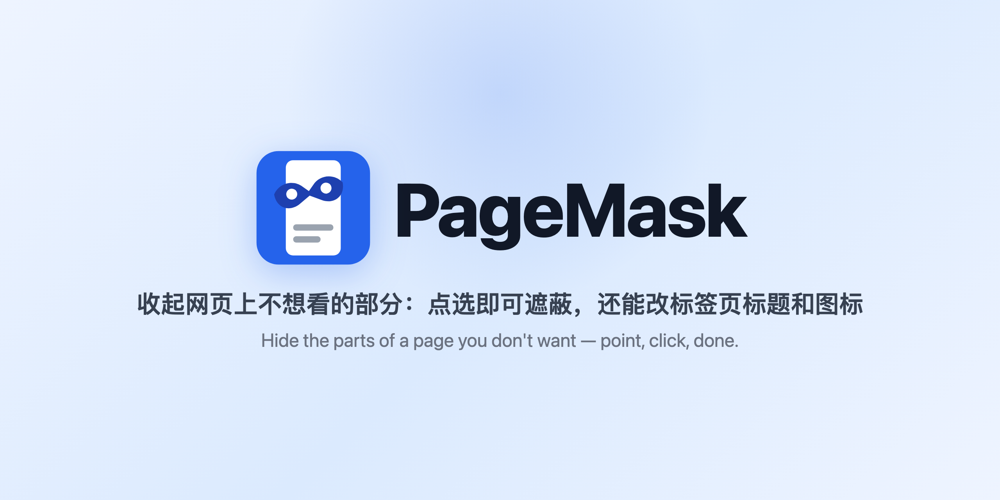

# PageMask · 收起网页上不想看的部分

[](https://cherishfall.github.io/page-mask/)

[](https://github.com/cherishfall/page-mask/releases/latest)
[](https://github.com/cherishfall/page-mask/actions/workflows/ci.yml)
[](LICENSE)


> 点选网页上不想看的元素把它们收起来；标签页标题和图标也能一起变低调。
> Hide the parts of a page you don't want — and keep the tab low-key.

[落地页](https://cherishfall.github.io/page-mask/) · [文档与资源](#文档与资源) · [中文](#中文) / [English](#english)

---

## 中文

**PageMask** 是一个 Chrome 扩展：在你主动添加的网站上，用鼠标点选页面上不想看的部分（推广位、推荐流、侧栏……）把它们收起来。**你不主动设置，它不会改动任何网站；唯一的临时动作是「遮住这一页」，点一下才遮、刷新即消失。**

### 功能

- **点选收起** — 悬停高亮、点击选中、即时预览；三种方式：消失 / 留空 / 盖住
- **标签页标题与图标** — 标题自己写；图标可隐藏或换成内置的 10 个图标
- **整页变灰** — 按网站把整页变黑白，快捷键 `Ctrl/⌘+Shift+Y`
- **遮住这一页** — 一键把整页连标签页标题一起遮住，快捷键 `Ctrl/⌘+Shift+X`
- **悬浮按钮** — 页面右下角的胶囊：一键切换、按住拖动、透明度可调
- **全本地** — 没有账号、没有同步、不发起任何网络请求；设置可导出 / 导入

功能细节、使用方法与常见问题见[落地页](https://cherishfall.github.io/page-mask/)。

### 已知限制

- 不支持 `chrome://` 内部页、本地文件与 Chrome 商店页面；网页里嵌入的另一层页面（iframe）和组件内部区域（shadow DOM）暂时点不了，外层容器可以
- 「整页变灰」只是去色（不省流量、不代替广告拦截）；「遮住这一页」只挡眼睛不挡输入

### 安装

Chrome 应用商店还没上架。现在可以直接装 Releases 里的 zip，不用编译（需要 Chrome 116 或更高）：

1. 到 [Releases](https://github.com/cherishfall/page-mask/releases/latest) 下载最新的 `page-mask-*-chrome.zip`，解压到一个固定的空文件夹（升级时覆盖同一个文件夹）
2. 打开 `chrome://extensions` → 开启「开发者模式」→「加载已解压的扩展程序」→ 选择解压出来的文件夹

从源码构建：`npm ci && npm run build`（Node ≥ 22.13），然后在上一步选择 `.output/chrome-mv3`。

**升级**：覆盖到同一目录后到 `chrome://extensions` 点刷新，设置不丢（换文件夹 = 换身份 = 清空，所有扩展都这样）。

### 文档与资源

| 资源 | 说明 |
|---|---|
| [落地页](https://cherishfall.github.io/page-mask/) | 功能介绍 · 怎么用 · 常见问题 |
| [隐私政策（在线版）](https://cherishfall.github.io/page-mask/privacy.html) · [docs/PRIVACY.md](docs/PRIVACY.md) | 收集什么、怎么用、权限逐项说明（两版内容一致） |
| [在线更新日志](https://cherishfall.github.io/page-mask/changelog.html) · [CHANGELOG.md](CHANGELOG.md) | 每个版本的改动（中英对照） |
| [Releases](https://github.com/cherishfall/page-mask/releases) | 历史版本下载 |
| [Issues](https://github.com/cherishfall/page-mask/issues) | 问题反馈与想法 |
| [AGENTS.md](AGENTS.md) | 开发与协作约定 |
| [docs/design.md](docs/design.md) | 设计共识（实现的唯一依据） |
| [docs/design-ui.md](docs/design-ui.md) | 界面基础规范 |
| [docs/GLOSSARY.md](docs/GLOSSARY.md) | 术语表（唯一权威） |
| [docs/adr/](docs/adr/) | 架构决策记录 |
| [docs/dev/DEVLOG.md](docs/dev/DEVLOG.md) | 开发日志 |

### 面向开发者

技术栈：[WXT](https://wxt.dev)（MV3 框架）+ Vue 3 + TypeScript；测试用 vitest 与 puppeteer-core（Chrome for Testing）。Node ≥ 22.13，依赖一律精确版本。

```bash
npm ci                # 按 lockfile 精确安装
npm run dev           # 开发模式
npm run build         # 构建到 .output/chrome-mv3
npm run compile       # vue-tsc 类型检查
npm test              # 单元测试
npm run test:e2e      # 真实 Chrome 全量 E2E
```

代码导览：`entrypoints/` 各入口 · `core/` 纯逻辑（单测最密）· `ui/` Vue 组件 · `styles/` 设计 token。改完重新 build 后在 `chrome://extensions` 点刷新，已打开的页面要再刷新一次。

欢迎 fork 与二次开发（[MIT](LICENSE)）；问题与想法请到 [Issues](https://github.com/cherishfall/page-mask/issues)。

---

## English

**PageMask** is a Chrome extension: on sites you add yourself, click the parts of a page you don't want (promos, feeds, sidebars…) and they're gone. **Until you set it up, it changes no site — the only temporary action is Cover this page: one click to cover, gone on refresh.**

### Features

- **Point-and-click hiding** — hover to highlight, click to select, instant preview; three modes: disappear / keep space / cover
- **Tab title & icon** — write your own title; hide the icon or pick one of ten built-in ones
- **Whole-page gray** — turn the entire page black & white per site, shortcut `Ctrl/⌘+Shift+Y`
- **Cover this page** — hide the whole page with its tab title in one click, shortcut `Ctrl/⌘+Shift+X`
- **Floating button** — a capsule at the page corner: one-click toggle, draggable, adjustable opacity
- **Fully local** — no account, no sync, zero network requests; settings export / import

Details, usage and FAQ live on the [landing page](https://cherishfall.github.io/page-mask/).

### Known limitations

- Not supported: `chrome://` pages, local files, the Chrome Web Store; elements **inside** an embedded page (iframe) or a widget's internal area (shadow DOM) can't be picked yet — their containers can
- Whole-page gray only removes color (no data saved, not an ad blocker); the cover blinds but doesn't block input

### Install

The Chrome Web Store listing isn't live yet. For now, install the zip from Releases — no build step (Chrome 116 or later):

1. Download the latest `page-mask-*-chrome.zip` from [Releases](https://github.com/cherishfall/page-mask/releases/latest) and unzip it into a fixed, empty folder (overwrite that same folder for upgrades)
2. Open `chrome://extensions` → enable Developer mode → **Load unpacked** → select the unzipped folder

Building from source: `npm ci && npm run build` (Node ≥ 22.13), then select `.output/chrome-mv3` in step 2.

**Upgrading**: overwrite the same folder and hit reload on `chrome://extensions` — settings survive (a new folder means a new identity and a clean slate; that's true for every extension).

### Docs & resources

| Resource | What it is |
|---|---|
| [Landing page](https://cherishfall.github.io/page-mask/) | Features · how it works · FAQ |
| [Privacy policy (online)](https://cherishfall.github.io/page-mask/privacy.html) · [docs/PRIVACY.md](docs/PRIVACY.md) | What is collected, how it is used, permissions explained (both versions match) |
| [Changelog (online)](https://cherishfall.github.io/page-mask/changelog.html) · [CHANGELOG.md](CHANGELOG.md) | Every release, bilingual item by item |
| [Releases](https://github.com/cherishfall/page-mask/releases) | Download past versions |
| [Issues](https://github.com/cherishfall/page-mask/issues) | Bug reports and ideas |
| [AGENTS.md](AGENTS.md) | Development & collaboration conventions |
| [docs/design.md](docs/design.md) | The design consensus (single source of truth for implementation) |
| [docs/design-ui.md](docs/design-ui.md) | UI foundation spec |
| [docs/GLOSSARY.md](docs/GLOSSARY.md) | Glossary (authoritative) |
| [docs/adr/](docs/adr/) | Architecture decision records |
| [docs/dev/DEVLOG.md](docs/dev/DEVLOG.md) | Development log |

### For developers

Stack: [WXT](https://wxt.dev) (MV3 framework) + Vue 3 + TypeScript; tested with vitest and puppeteer-core (Chrome for Testing). Node ≥ 22.13, exact dependency versions.

```bash
npm ci                # exact install from the lockfile
npm run dev           # dev mode
npm run build         # build to .output/chrome-mv3
npm run compile       # vue-tsc typecheck
npm test              # unit tests
npm run test:e2e      # full E2E in real Chrome
```

Code tour: `entrypoints/` extension entries · `core/` pure logic (densest unit tests) · `ui/` Vue components · `styles/` design tokens. After rebuilding, hit reload on `chrome://extensions` and refresh open tabs.

Forks and secondary development welcome ([MIT](LICENSE)); bugs and ideas go to [Issues](https://github.com/cherishfall/page-mask/issues).

---

## License

[MIT](LICENSE) © cherishfall
